# Home in Review

A monthly report of your home, made from data Home Assistant already has. Once a month it puts together
**how much energy the house used and what it cost, where it went, how the weather compared to normal and how
warm, humid and fresh it was inside**. The result is a calm, scrollable presentation in the sidebar, one topic
per screen.

Install from the Marketplace (Home Assistant 2026.11+), restart, then add the integration. Other ways: see
[Installation](#installation).

> **Status: early test version (0.3).** It works on the author's own installation and is now shared with a few
> testers. Expect rough edges. Please [open an issue](https://github.com/fbloemhof/ha-home-in-review/issues) with
> what you see.

## Built with AI

This integration was designed and written together with an AI coding assistant
([Claude Code](https://claude.com/claude-code) by Anthropic). A human (the maintainer) chose the features,
tested every version on a real Home Assistant installation and reviews every change. Commits written with AI
help are marked with a `Co-Authored-By: Claude` line. If something looks wrong, it may well be. Please report it.

## What you get

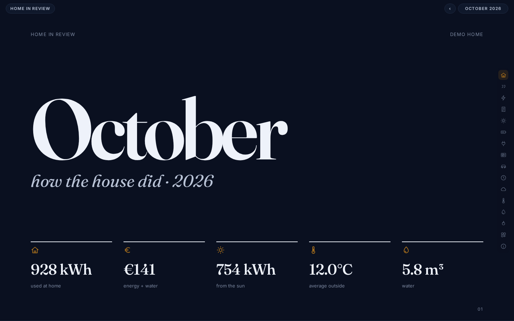

| Slide | Source | Shown when |
|---|---|---|
| Cover with key figures | everything below | always |
| In short: a written summary | your own AI Task entity | you choose one in the options |
| Electricity: use per day, grid in/out, self-sufficiency, base load | energy dashboard | a grid source is set up |
| Costs: bought, sold, gas, fixed costs, average price | the energy dashboard's cost statistics | prices are set in the energy dashboard |
| Solar: production, share used at home, sunshine vs. normal | energy dashboard, Open-Meteo | solar is set up |
| Batteries: charged, discharged, efficiency | energy dashboard | batteries are set up |
| Where it went: devices ranked, untracked rest, value | energy dashboard "individual devices" | devices are set up |
| Heat pump (any brand): electricity, heat, COP, kWh per degree day | energy sensors you choose | set in the options |
| Car (any brand): km, charging at home, kWh per 100 km; with evcc also sessions, cost and solar share; with TeslaMate also trips and Wh/km | odometer and charger sensors, evcc or TeslaMate | set in the options |
| Daily rhythm: average power per hour of day, busiest hour | energy dashboard | a grid source is set up |
| Weather: temperature, rain, sunshine, degree days vs. 1991–2020 | Open-Meteo and/or your own outdoor sensor and rain gauge | your home has a location |
| Indoors: temperature, humidity and CO₂ per area | your sensors | climate sensors are assigned to areas |
| Water and gas; for gas also use per degree day and the split between heating and hot water/cooking | energy dashboard, weather | set up |
| Your figures: any statistic as a total, average, extreme, or hours or days above a threshold | your choice | added in the options |

Every figure is compared with the same month last year (when available) or the average of the last twelve
months, with a small 13-month trend chart. A **year review** (January–December, or any other start month, for
example a heating season) brings the months together with a bar per month next to last year.

There is **nothing to configure** to get started: the integration reads your energy dashboard and finds your
indoor sensors through their areas. The report follows Home Assistant's language (English, Dutch, German,
French, Spanish and Italian so far) and your unit system and currency.

| | |
|---|---|
| 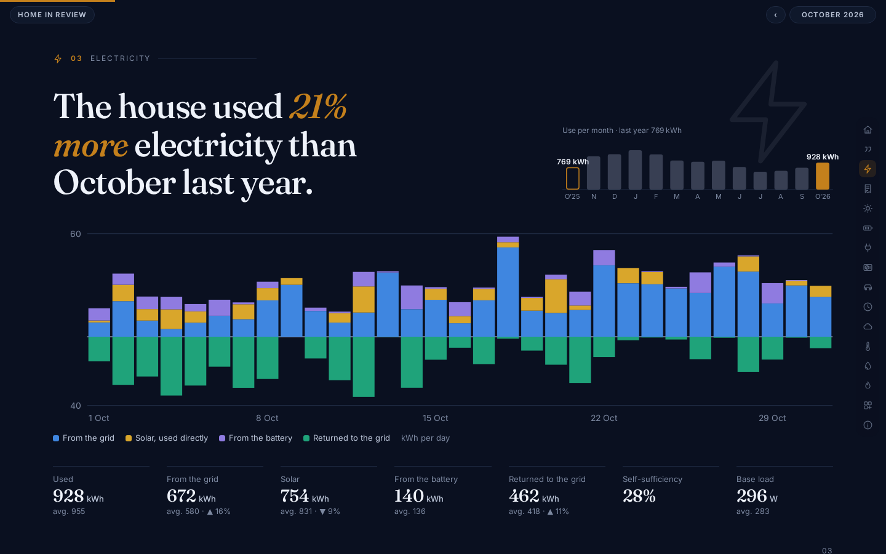 | 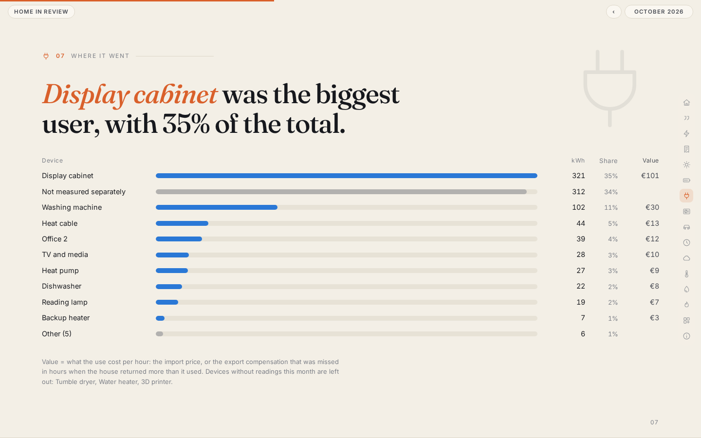 |
| 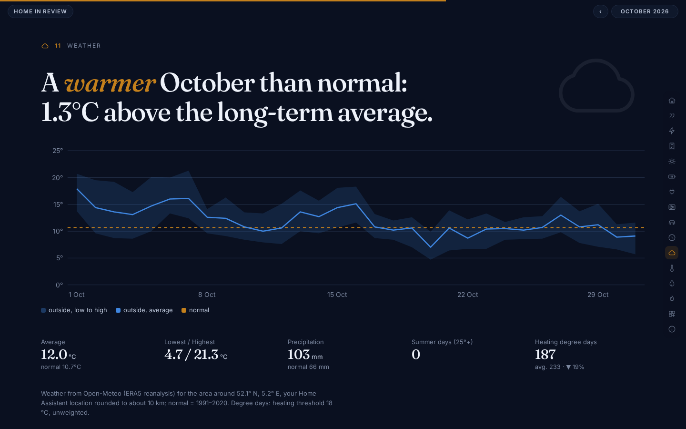 | 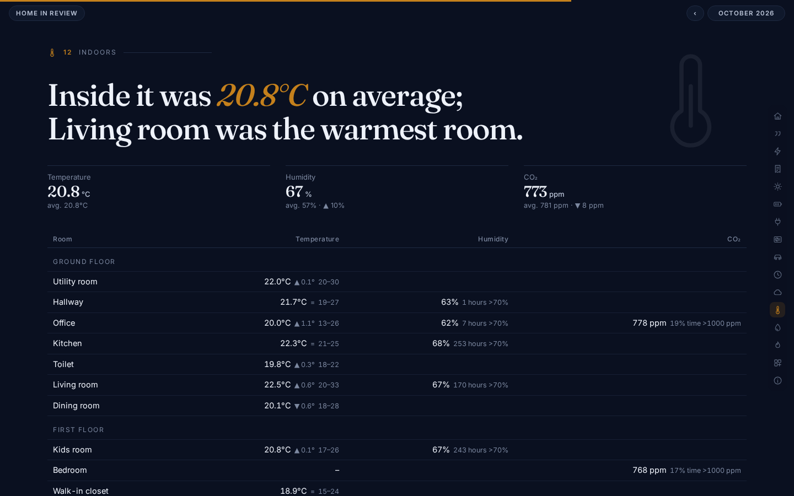 |
| 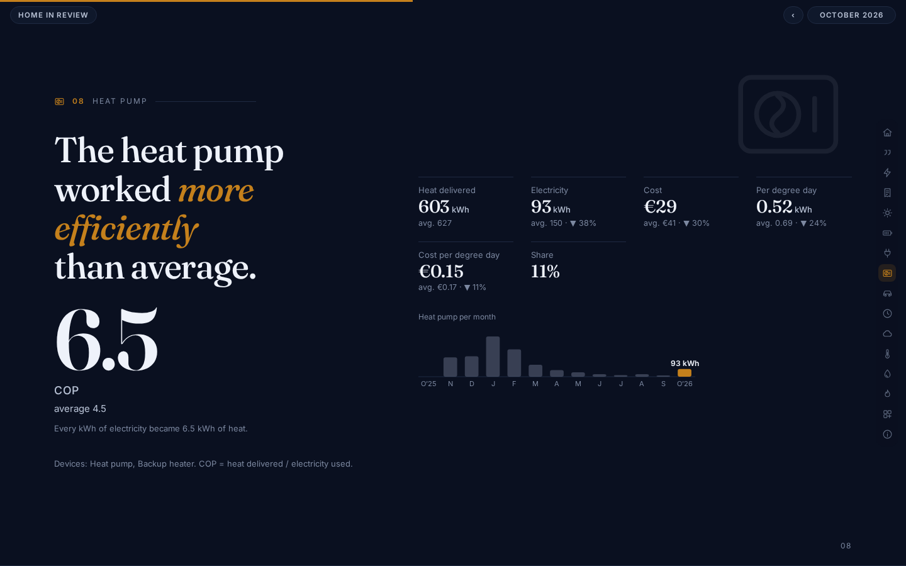 | 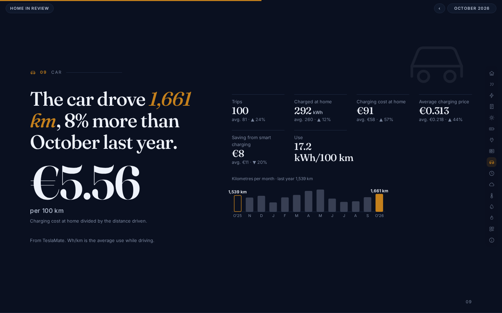 |
| 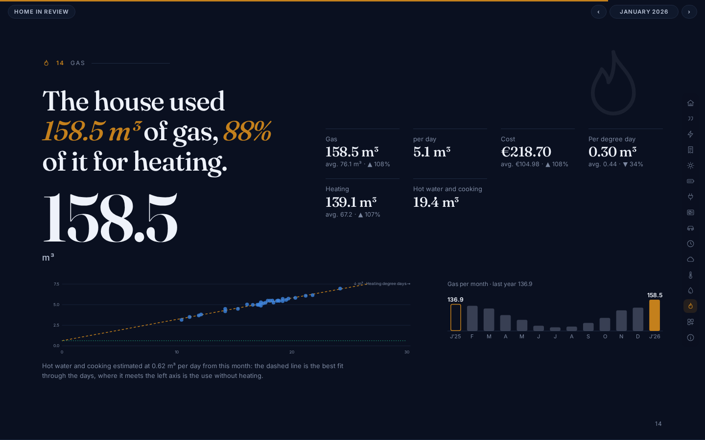 | 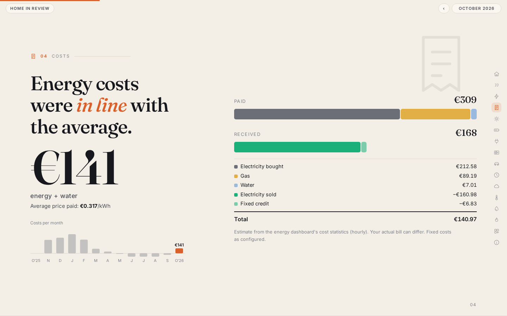 |
| 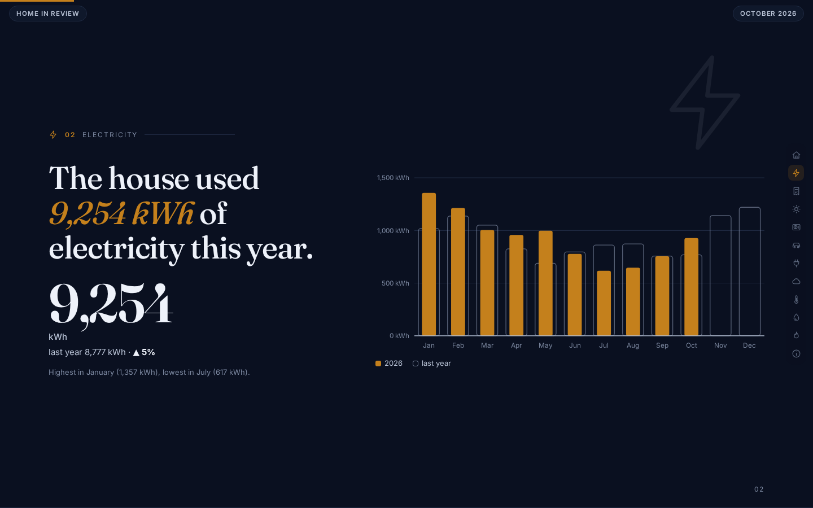 | 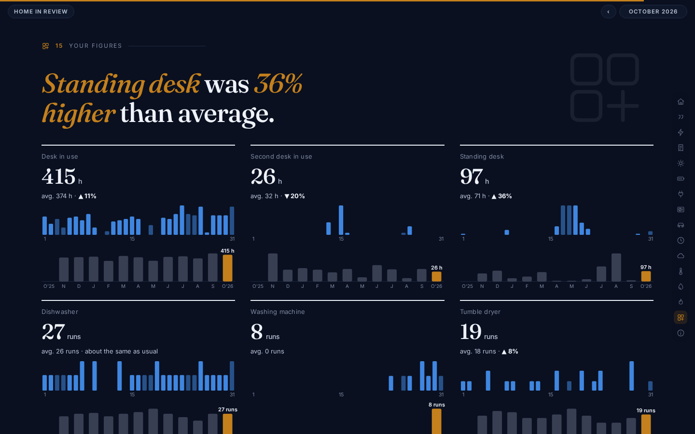 |

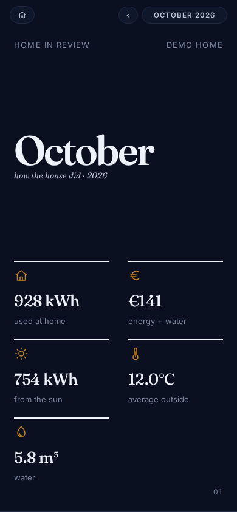

*Screenshots use anonymised demo data, in the night theme (and two in the light theme).*

## Installation

1. Click the button above (Home Assistant 2026.11 or newer) and install **Home in Review**, then restart Home Assistant.
2. Add the integration:

   

On setup it generates the last 12 months from your long-term statistics in the background, so you can browse a
year of reports right away. After that, a new report is made on the 1st of every month at 07:00.

Without the button, or with HACS on an older Home Assistant

1. Open **HACS** (or **Settings → Marketplace**) → ⋮ → **Custom repositories**.
2. Add `https://github.com/fbloemhof/ha-home-in-review` with type **Integration**.
3. Install **Home in Review** and restart Home Assistant.
4. Go to **Settings → Devices & services → Add integration → Home in Review**.

Manual install: copy `custom_components/home_in_review` into your `config/custom_components` folder and restart.

## Options

**Settings → Devices & services → Home in Review → Configure**:

- **Settings**, one form with collapsible sections:
  - **Schedule and notifications**: notify services (the notification opens the report), the day and time last
    month's report is made (default the 1st at 07:00), the month the year review starts, and whether only
    administrators can view the reports.
  - **Energy, costs and heat pump**: fixed costs per day and/or month (including tax); the largest plausible
    grid use per hour (meter jumps above it are skipped as glitches; default 25 kWh, roughly a 3 × 35 A
    connection; 3 × 25 A is about 17 kWh). For a heat pump of any brand: one or more energy sensors for its
    electricity (its own integration, a kWh meter or a smart plug; for example compressor and backup heater)
    and, optionally, sensors for the heat it delivers (often heating and hot water separately), which adds the COP.
  - **Indoor climate and weather**: areas that are not indoors, an outdoor temperature sensor, a rain gauge, and
    whether to use Open-Meteo at all.
  - **Car**: for any brand, each car's odometer sensor and your charger's energy sensor. Richer sources are used
    first when filled in: [evcc](https://evcc.io) (its URL; charging sessions, cost and solar share per
    vehicle) and [TeslaMate](https://github.com/teslamate-org/teslamate) (the URL of its Grafana and a token of a
    Grafana service account with the *Viewer* role; trips, charging at home and elsewhere, Wh/km).
  - **AI summary**: an AI Task entity (OpenAI, Anthropic, Google or a local model set up in Home Assistant) and
    optional extra instructions. The integration computes the comparisons itself and hands the model plain,
    verified statements to phrase; the text is labelled as written by AI.
- **Add your own figure**: any statistic as a total, average, highest, lowest, or the hours or days in which it
  was above a threshold (for example the days the wood stove burned).
- **Remove your own figures**.

## Actions

- `home_in_review.generate`: (re)make the report for one month (`month: "2026-10"`, default: last month), optionally with notifications.
- `home_in_review.backfill`: make missing reports for earlier months (`overwrite: true` re-makes existing ones; normally not needed, reports update themselves).

## How it works

- **Energy** comes from the hourly long-term statistics of the sensors in your energy dashboard. Costs come
  from the cost statistics Home Assistant keeps for the energy dashboard. So with a dynamic tariff, every hour
  is priced at that hour's price. A device's "value" is what its use cost per hour: the import price, or, in hours
  when the house returned more than it took from the grid, the export compensation it missed.
- **Glitches**: a meter step larger than the configured maximum per hour is skipped and mentioned in the report.
  A meter that resets (for example per charging session) is handled.
- **Indoor climate**: all temperature, humidity and CO₂ sensors with long-term statistics that are assigned to
  an area, either directly or through their device. When an area has a device that measures both temperature and humidity, only
  those temperature readings count, so motion sensors, pipe probes and the chip temperature of CO₂ modules
  don't skew the room. Per area the median is used. Implausible values (e.g. water temperatures) are dropped.
- **Indoors vs. outdoors**: until you choose areas in the options, areas and floors whose name says outdoors
  (garden, balcony, terrace, shed, driveway and the like, also as the end of a compound word such as
  "Backyard") are left out. Garages and storage rooms are not, because that differs per home. The last slide of
  every report lists what was left out and why.
- **Costs** in the totals are electricity bought minus sold, plus gas and the fixed costs you entered. Water is
  shown on its own slide.
- **Weather** comes from [Open-Meteo](https://open-meteo.com) (ERA5 reanalysis, free for non-commercial use, no
  account or setup). It uses your home's location from Home Assistant. Normals are the 1991–2020 averages for
  your area, computed once and cached. A Home Assistant weather entity can't be used for this: weather
  entities keep no history. You can use your own outdoor temperature sensor instead, and switch Open-Meteo off.
- **Heat pump and gas**: degree days use a base of 18 °C (65 °F), unweighted. Gas is split into heating and hot
  water/cooking with a degree-day regression: daily gas use ≈ base + k × degree days. The base comes from the
  option "Gas for hot water and cooking per day", or is estimated per month when the month has enough spread in
  degree days (in a month without heating all gas counts as base).
- **Year review** is put together from the monthly reports; a running year is shown as "so far" and compared
  with the same months a year earlier.
- Reports are stored as JSON in `config/home_in_review/` and rendered when you open them, so improvements to
  the layout also apply to older months. Each report remembers the version and settings it was made with; after
  an update or a change of settings the outdated months are re-made in the background. AI summaries are only
  written again when the figures behind them changed.

## Privacy and security

- Reports are only served to logged-in Home Assistant users (`/api/home_in_review/...` requires authentication;
  the panel uses short-lived signed links). By default everyone with a login in your household can open them;
  with **Only administrators can view the reports** other users get no panel and no access.
- Report pages load nothing from elsewhere and can't send anything (strict Content-Security-Policy).
- Outside services, all optional except Open-Meteo, which you can switch off:
  - **Open-Meteo** receives your location **rounded to 0.1° (about 10 km)** and the dates.
  - **evcc**: only your own evcc, read-only.
  - **TeslaMate**: only your own Grafana, read-only. Addresses are checked: only http(s), no credentials in the
    address, https required when the token would leave your network, and redirects are never followed.
  - **AI summary**: your own AI Task entity receives the report's figures as plain sentences, including the
    names of your energy-dashboard devices (no entity IDs, no raw sensor data, no room names).
- The TeslaMate token is stored in Home Assistant's config entry, like other integrations' credentials. Use a
  Grafana service account with only the Viewer role.
- Reports are stored as JSON in `config/home_in_review/`, next to Home Assistant's own data (and included in its
  backups).

## Requirements

- Home Assistant 2025.4 or newer, with the recorder (long-term statistics) and the energy dashboard set up.
  The integration's own icon shows from Home Assistant 2026.3.
- Data older than your recorder's long-term statistics cannot be reported.

## Roadmap

- Listing in the default HACS / Marketplace catalogue
- More languages (translations welcome: `i18n.py` for the report, `tools/translations.py` and
  `tools/translations_extra.py` for the settings)

See [CHANGELOG.md](CHANGELOG.md) for what changed in each version.

## License

MIT
